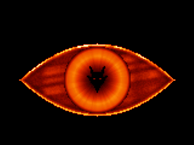

# CYD Fire Eye

A slowly pulsing eye of fire with a devilish pupil for the ESP32 Cheap Yellow Display (ESP32-2432S028R).

- **Idle:** the fire breathes slowly and the eye glances around now and then
- **Tap:** the eye looks at your finger, the fire flares and embers burst where you touched
- **Hold:** the pupil grows, the iris swirls faster and the flames roar

## Install
Web installer (Chrome/Edge): **https://martindamp.github.io/CYD-hal9000/**

Or build yourself: `pio run -e cyd -t upload`

## How it works
- `src/fire_eye.h` — platform-independent engine: rising "doom-style" fire in a 160x120 heat
  buffer, the eye and pupil drawn into it each frame, upscaled 2x with interpolation.
- `src/main.cpp` — display (TFT_eSPI with DMA), touch (XPT2046) and the main loop.
- `tools/sim/render.sh` — runs the same engine on a PC and renders `docs/preview.gif` + PNGs.

## Release
Bump `VERSION` and push to `main`. GitHub Actions builds the firmware and deploys the web installer to GitHub Pages
(Settings → Pages → Source must be **GitHub Actions**).

## Troubleshooting
See the comments at the bottom of `platformio.ini` (inverted colours, red/blue swapped) and `TOUCH_FLIP_X/Y` in `src/main.cpp`.
